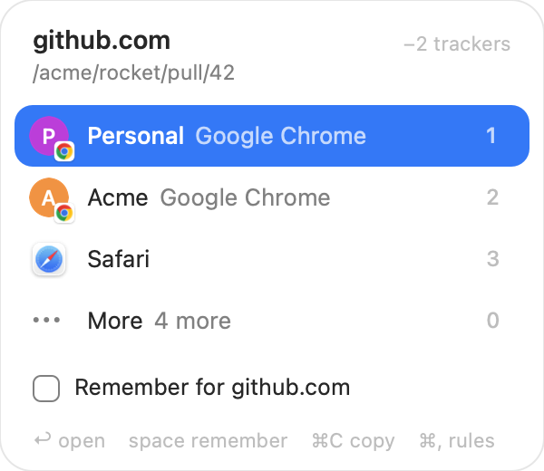

# Hop

A tiny link router for macOS 26, written in Rust. It is a native AppKit app with no webview, and the app bundle is under 500 KB.

Make Hop your default browser. Each link then follows a rule, or it opens a Liquid Glass picker under the cursor.

<p align="center">
  <picture>
    <source media="(prefers-color-scheme: dark)" srcset="docs/picker-dark.png">
    
  </picture>
</p>

You click a link, and the picker opens with the first row under the cursor. Press `1`, or click, to open the link in that browser or profile. Tick Remember to send every link for that site there from now on.

Install it with one command. It needs macOS 26 on Apple silicon, and no Rust:

```sh
curl -fsSL https://raw.githubusercontent.com/BudhirajaMadhav/hop/master/install.sh | sh
```

The command downloads Hop.app and installs it with the `hop` command. It asks for your favorites, then asks macOS to make Hop the default browser. Click "Use Hop" when macOS asks.

To build from source, clone the repo and run `./bundle.sh install`. This needs Rust. `./bundle.sh release` publishes the build as the GitHub release that the command downloads.

Then use the `hop` command:

```sh
hop favorites   # pick and order the browsers and profiles at the top of the picker (↑↓, space, shift+↑↓, enter)
hop default     # make Hop the default browser (macOS asks you to confirm)
hop rules       # open the rules file
hop list        # print the picker labels
hop <url>       # open a link through Hop
hop uninstall   # give your links back to a browser you choose, then remove Hop
```

`hop favorites` is a small list in the terminal. The numbers are the order of the favorites, which is also their shortcut in the picker:

```
$ hop favorites
Pick your favorites. They go at the top of the picker, in this order.
↑↓ move · space add/remove · shift+↑↓ reorder · enter save · q cancel
 ›  1 Google Chrome (Personal)
    2 Google Chrome (Acme)
    3 Safari
    · Arc
    · Firefox
    · Microsoft Teams
```

A reinstall keeps Hop as the default browser, because macOS stores the bundle ID, not the file.

**Picker:** `1`–`9` (or `⌘1`–`⌘9`) or a click opens a top choice · `0` opens More, a menu of the rest · `↩` opens the selected row · `space` or a click ticks Remember for this domain (holding `⌥` does the same) · `⌘C` copies the link · `esc` closes · `⌘,` opens the rules file · `⌘Q` quits.

**Rules** are in `~/.config/hop/rules`. Open Hop.app again to edit the file.

```
+Google Chrome (Acme)                      # pin a top choice; the rest go under More
+Safari
github.com/acme = Google Chrome (Acme)   # domain[/path] = picker label | app name
youtube.com = Safari
figma.com = Figma
!Microsoft Teams                            # hide a row
```

Hop also removes tracking parameters (`utm_*`, `fbclid`, `gclid`, …) before it opens a link. `hop list` prints the picker labels.
